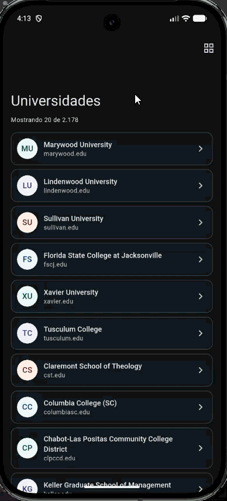

# Universidades — Prueba técnica Frontend Engineer de Tyba

App en Flutter que descarga un listado de universidades, lo muestra en lista o
cuadrícula con scroll infinito y permite asignarle a cada una una imagen y un
número de estudiantes.

## Demo

Flujo principal: la lista carga las universidades, se cambia a cuadrícula, se
abre el detalle de una universidad, se le asigna una imagen y un número de
estudiantes, y al volver la lista muestra el avatar y el badge actualizados.

<p align="center">
  
</p>

Para instalarla en un dispositivo Android se puede generar el APK de release:

```bash
flutter build apk --release
```

El archivo queda en `build/app/outputs/flutter-apk/app-release.apk`.

## Funcionalidades

| Requerimiento | Implementación |
|---|---|
| Carga por network request | `GET` a `universities.json` con `http`, timeout de 15 s y errores traducidos a mensajes en español. |
| Lista y cuadrícula | Botón en el AppBar que alterna entre `SliverList` y `SliverGrid` responsivo. |
| Detalle con imagen | Al tocar una universidad se abre su detalle; un bottom sheet permite elegir la imagen desde cámara o galería. |
| Número de estudiantes con validaciones | Campo numérico que solo acepta dígitos y valida: obligatorio, entero, mayor que cero y como máximo 1.000.000. |
| Bono: infinite scroll | De 20 en 20, sin librerías externas. |

Las imágenes y el número de estudiantes se guardan en memoria durante la
sesión; el enunciado no pide persistirlos entre sesiones.

Extras:

- Tema claro y oscuro con Material 3 (la app arranca en modo oscuro).
- Avatares circulares con las iniciales de la universidad cuando no tiene imagen.
- Transición `Hero` del avatar entre la lista y el detalle.
- Contador "Mostrando X de Y" bajo el título.
- Manejo de errores con pantalla de reintento.
- Badge con el número de estudiantes en la lista para las universidades editadas.

## Cómo ejecutar

La versión de Flutter está fijada en `.fvmrc` (3.41.9). Con
[FVM](https://fvm.app) basta con anteponer `fvm` a los comandos
(`fvm flutter run`).

```bash
flutter pub get
flutter run
flutter test
flutter test --coverage
```

Plataformas soportadas: Android e iOS. Web no está soportado porque la
selección de imagen usa archivos locales y la cámara del dispositivo.

## Arquitectura

Clean Architecture "light", con la regla de dependencia
`presentation → domain ← data`. Es "light" porque mantiene la separación de
capas y la regla de dependencia, pero sin casos de uso que solo deleguen al
repositorio; la lógica de negocio real, la validación del número de
estudiantes, vive en el dominio como función pura.

Cada capa contiene:

- **domain**: entidades (`University`, `UniversityCustomData`), el contrato
  `UniversitiesRepository` y la validación del número de estudiantes. No
  depende de Flutter, `http` ni Riverpod.
- **data**: el modelo que parsea el JSON, el parser y la implementación del
  repositorio con `http`.
- **presentation**: providers de estado, pantallas y widgets.

```
lib/
├── main.dart
├── app.dart
├── core/
│   ├── errors/app_exception.dart
│   ├── services/image_picker_service.dart
│   └── theme/app_theme.dart
└── features/universities/
    ├── domain/
    │   ├── entities/          # University, UniversityCustomData
    │   ├── repositories/      # UniversitiesRepository (contrato)
    │   └── validators/        # validateStudents
    ├── data/
    │   ├── models/            # UniversityModel (fromJson, toEntity)
    │   ├── parsers/           # parseUniversities
    │   ├── repositories/      # UniversitiesRepositoryImpl
    │   └── providers.dart     # provider del repositorio
    └── presentation/
        ├── providers/         # universidades, datos editados, image picker
        ├── screens/           # lista y detalle
        ├── utils/             # initialsFor, formatThousands
        └── widgets/           # ítems, avatar, badge, formulario, error
```

El estado se maneja con `flutter_riverpod` 3, sin code generation.

## Decisiones técnicas

- **El `id` es el índice en la lista.** El JSON no trae id y ni el nombre ni
  los dominios son únicos (por ejemplo, "College of DuPage" aparece dos veces y
  "rutgers.edu" está en varias universidades).
- **Limpieza de nombres en el modelo.** Algunos nombres traen `&amp;` y el
  espacio invisible `​`; son los únicos casos presentes en los datos, así
  que se resuelven con dos `replaceAll` en lugar de un decodificador genérico.
- **Parseo en `parseUniversities`.** Está separado del repositorio para que
  cualquier fuente de datos (red, asset local, caché) lo reutilice.
- **Errores traducidos a `AppException` en la capa de datos.** La presentación
  nunca ve `ClientException`, `TimeoutException` ni `FormatException`, solo un
  mensaje listo para mostrar.
- **Timeout de 15 s en la petición.** `http` no tiene timeout por defecto, así
  que sin él una red colgada dejaría la carga esperando indefinidamente.
- **Reintento automático de Riverpod desactivado.** Riverpod 3 reintenta los
  providers que fallan y mantiene el estado en carga mientras tanto; sin red,
  el usuario vería el spinner cerca de un minuto. La pantalla ofrece un botón
  "Reintentar" explícito.
- **Paginación en memoria en el notifier.** La API devuelve todas las
  universidades en una sola respuesta, así que el notifier solo controla
  cuántas son visibles.
- **`NotificationListener` en vez de `ScrollController`.** Se pide la siguiente
  página cuando quedan menos de 400 px por recorrer, con una guarda
  (`_requestedAt`) para pedir como máximo una página por cantidad de ítems
  visibles.
- **Modo lista/cuadrícula como estado local.** Solo lo usa una pantalla, así
  que va con `setState` y no en un provider.
- **Datos editados en un provider separado.** La imagen y el número de
  estudiantes viven en un mapa indexado por `id`, aparte de la lista, para que
  recargarla no borre lo editado. El mapa se reemplaza en cada cambio en lugar
  de mutarse.
- **Validación en el dominio como función pura.** `validateStudents` es una
  regla de negocio y se prueba sin widgets.
- **`ImagePickerService` inyectado por provider.** Permite reemplazarlo por un
  fake y probar el detalle sin cámara ni galería.

## Cambiar a un archivo JSON local

1. Registrar el archivo como asset en `pubspec.yaml`
   (por ejemplo, `assets/universities.json`).
2. Crear otra implementación de `UniversitiesRepository` que lea el asset y
   reutilice el parser:

   ```dart
   class LocalUniversitiesRepository implements UniversitiesRepository {
     @override
     Future<List<University>> getUniversities() async {
       final body = await rootBundle.loadString('assets/universities.json');
       return parseUniversities(body);
     }
   }
   ```

3. Devolver esa implementación en `universitiesRepositoryProvider`.

El dominio y la presentación no cambian, porque dependen solo del contrato.

## Tests

- **Datos:** parseo del modelo, limpieza de nombres, ids por posición
  (incluidos nombres repetidos) y traducción de errores del repositorio a
  `AppException` (status de error, timeout, red y JSON inválido).
- **Dominio:** reglas de validación del número de estudiantes.
- **Estado:** paginación de 20 en 20 y datos editados por el usuario.
- **Pantallas:** carga, error con reintento, cambio lista/cuadrícula, infinite
  scroll, detalle (imagen y formulario) y el flujo completo
  lista → detalle → lista.

La red y los servicios de plataforma se reemplazan por fakes: `MockClient` de
`http` para el repositorio, y repositorio y selector de imágenes falsos
inyectados con overrides de Riverpod.

## Mejoras futuras

- Paginación en el repositorio (offset/limit) si la API paginara.
- Seguir cargando páginas aunque las primeras 20 universidades no llenen la
  pantalla (tablets o web en modo cuadrícula); hoy la paginación depende de que
  haya scroll.
- Modo offline con fallback a un JSON local.
- Persistencia de las ediciones entre sesiones.
- Abrir los sitios web con `url_launcher`.
- Búsqueda por nombre.
- CI con GitHub Actions.

## Uso de herramientas de IA

Usé Claude Code como asistente de implementación. El diseño, las decisiones
técnicas y la revisión del código son míos; están detallados en la sección de
decisiones.
